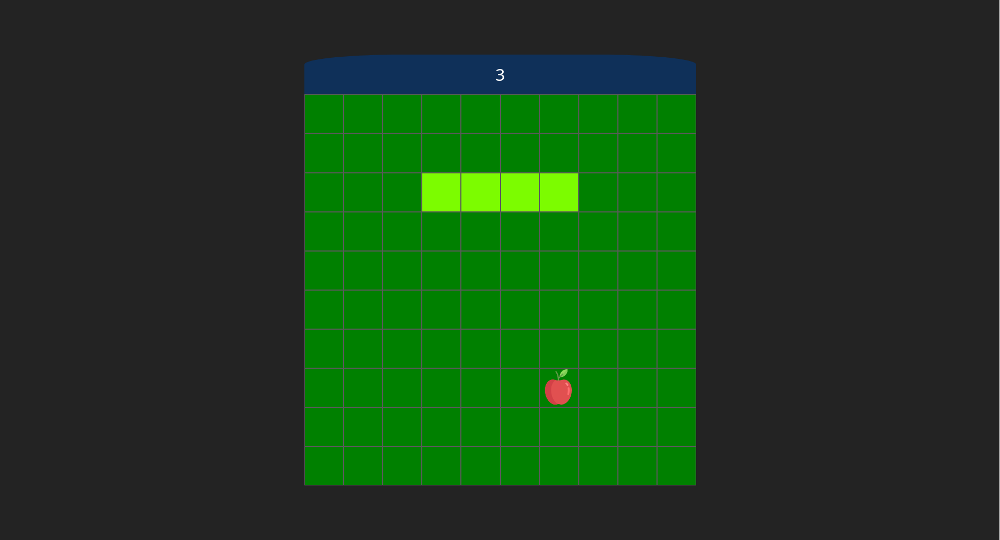
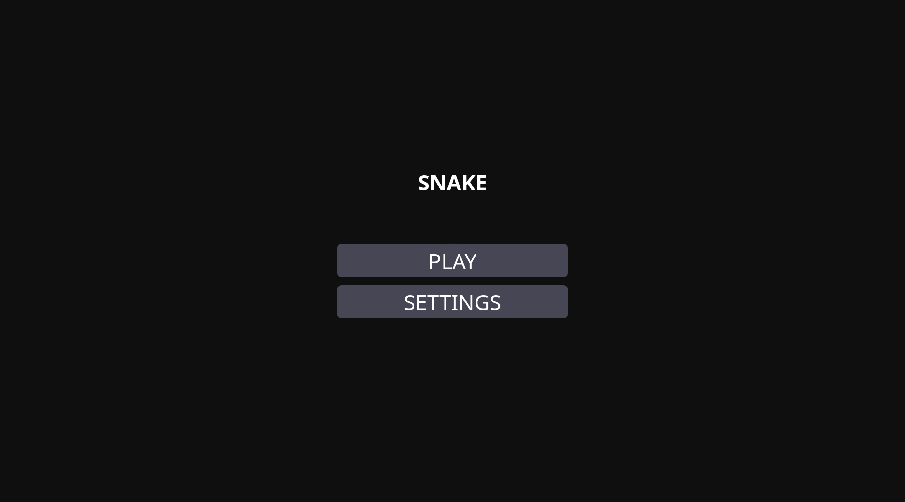
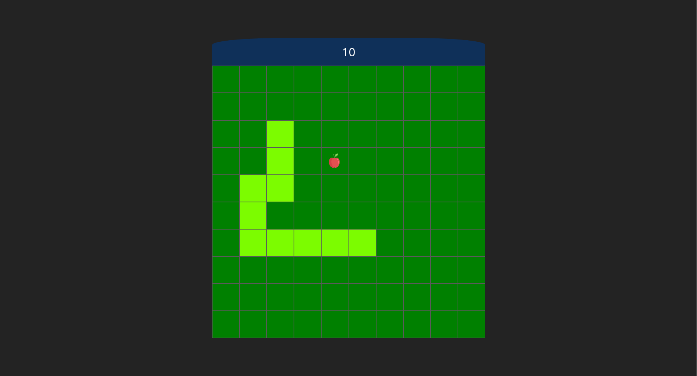
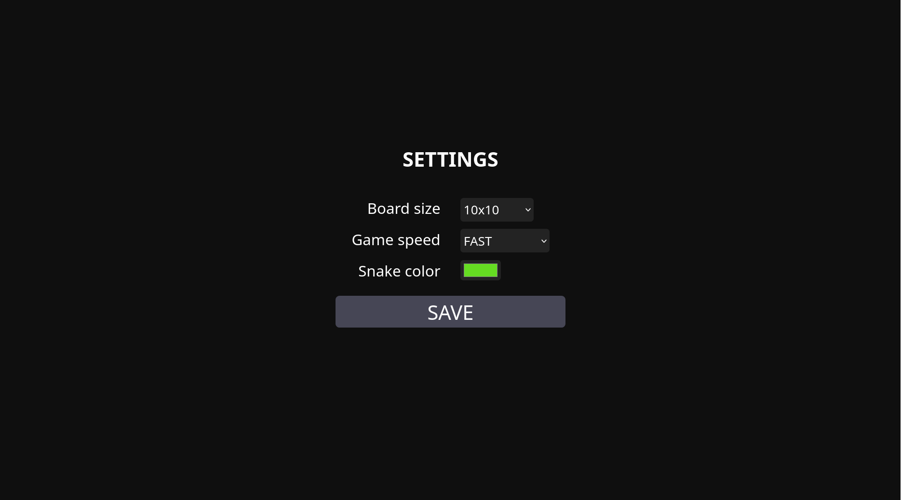
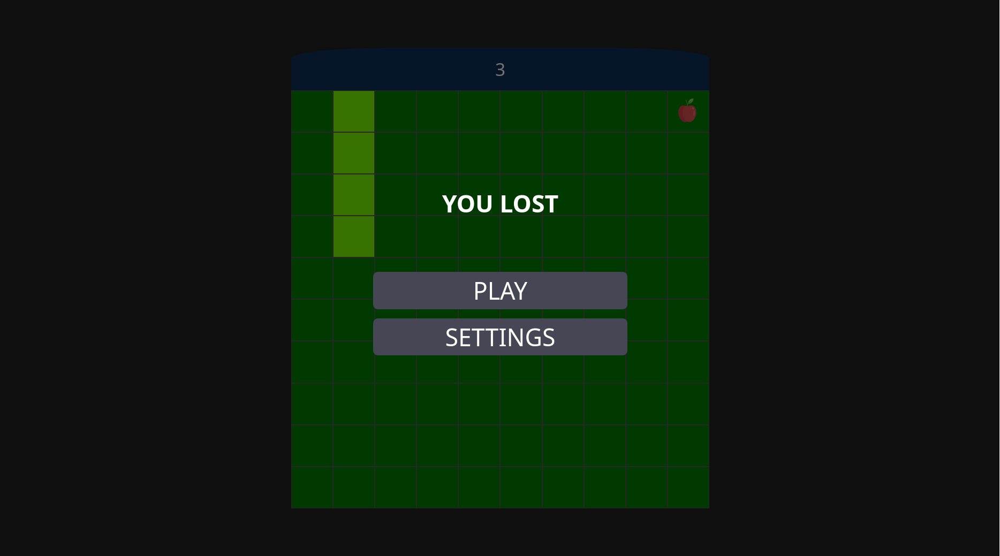

<div align="center">



# Snake

**Przeglądarkowa gra Snake stworzona w TypeScript, HTML i CSS**

[](https://github.com/a-jadczak/snake/commits)
[](https://github.com/a-jadczak/snake)
[](https://github.com/a-jadczak/snake)

</div>

## 📋 Spis treści

- [🎯 Opis](#-opis)
- [✨ Funkcje](#-funkcje)
- [🚀 Demonstracja](#-demonstracja)
- [🖼️ Zrzuty ekranu](#️-zrzuty-ekranu)
- [🛠️ Technologie](#️-technologie)
- [🏁 Pierwsze kroki](#-pierwsze-kroki)
- [📖 Obsługa](#-obsługa)
- [📁 Struktura projektu](#-struktura-projektu)
- [📄 Licencja](#-licencja)

## 🎯 Opis

### **Snake to jednostronicowa gra przeglądarkowa, w której kierujesz rosnącym wężem po planszy.**

Zbieraj jabłka, aby zdobywać punkty i wydłużać węża. W miarę zapełniania planszy omijaj ściany i ciało węża.

## ✨ Funkcje

### Sterowanie klawiaturą

Steruj za pomocą strzałek lub klawiszy **W**, **A**, **S** i **D**.

### Jabłka i punktacja

Każde jabłko zwiększa wynik i wydłuża węża. Zapełnij planszę, aby wygrać.

### Ustawienia gry

Przed rozpoczęciem gry wybierz planszę **8 × 8**, **10 × 10** lub **15 × 15**, ustaw prędkość (**SLOW** lub **FAST**) i kolor węża.

## 🚀 Demonstracja

Uruchom lokalny serwer, aby zagrać w przeglądarce.

### **[→ Otwórz lokalną wersję demonstracyjną](http://localhost:8000/)**

> Instrukcja uruchomienia serwera znajduje się w sekcji „Praca nad aplikacją”.

## 🖼️ Zrzuty ekranu

<p align="center">
  
</p>

<p align="center">
  
</p>

<p align="center">
  
</p>

<p align="center">
  
</p>

<p align="center">
  
</p>

## 🛠️ Technologie

| Kategoria    | Technologie                   |
| ------------ | ----------------------------- |
| **Frontend** | `HTML` · `CSS` · `TypeScript` |

## 🏁 Pierwsze kroki

### 📋 Wymagania

| Wymaganie  | Wersja lub przeznaczenie                         |
| ---------- | ------------------------------------------------ |
| Python     | Python 3 do uruchomienia lokalnego serwera HTTP  |
| TypeScript | Kompilator `tsc` do ponownej kompilacji skryptów |

### 📦 Instalacja

**1. Sklonuj repozytorium**

```bash
git clone https://github.com/a-jadczak/snake.git
```

**2. Przejdź do katalogu projektu**

```bash
cd snake
```

### 💻 Praca nad aplikacją

Uruchom lokalny serwer HTTP w katalogu głównym projektu.

```bash
python3 -m http.server 8000
```

Następnie otwórz [http://localhost:8000](http://localhost:8000).

### 🏭 Kompilacja produkcyjna

Po zmianie plików w `src/` ponownie skompiluj kod TypeScript.

```bash
tsc -p tsconfig.json
```

Skompilowane pliki JavaScript trafiają do katalogu `dist/`.

## 📖 Obsługa

1. Kliknij **PLAY**.
2. Steruj za pomocą strzałek lub klawiszy **W**, **A**, **S**, **D**.
3. Zbieraj jabłka, aby zdobywać punkty, i omijaj ściany.
4. Zapełnij planszę, aby wygrać.

## 📁 Struktura projektu

```text
snake/
├── .github/
│   ├── assets/                 # Zrzuty ekranu projektu
│   └── portfolio.yaml
├── dist/                       # Skompilowane pliki JavaScript
├── public/                     # Grafika jabłka
├── src/                        # Logika gry, renderowanie, sterowanie i ustawienia
├── styles/                     # Style gry i menu
├── index.html                  # Plik startowy aplikacji
└── tsconfig.json               # Konfiguracja kompilatora TypeScript
```

## 📄 Licencja

Projekt jest udostępniany na [licencji MIT](../../LICENSE).

<div align="center">

**[⬆ Wróć na początek](#snake)**

</div>
