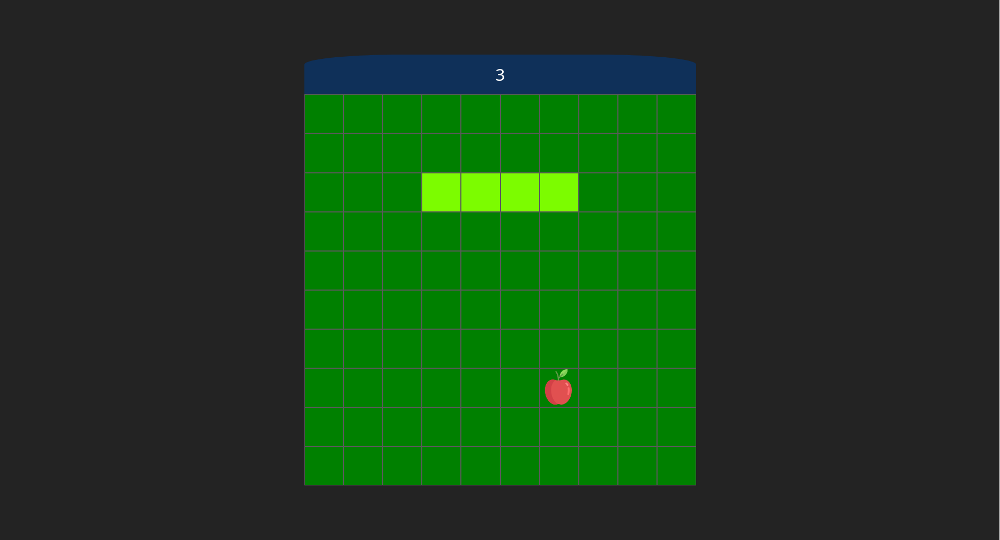
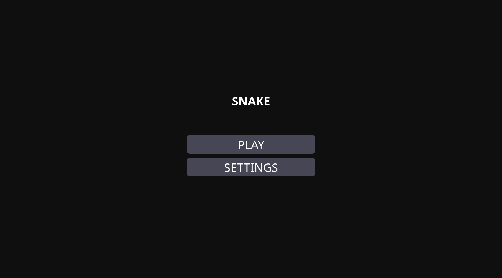
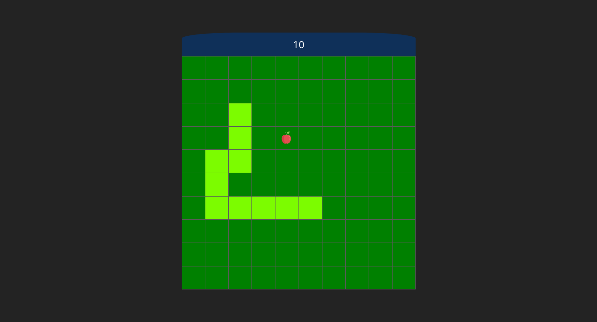
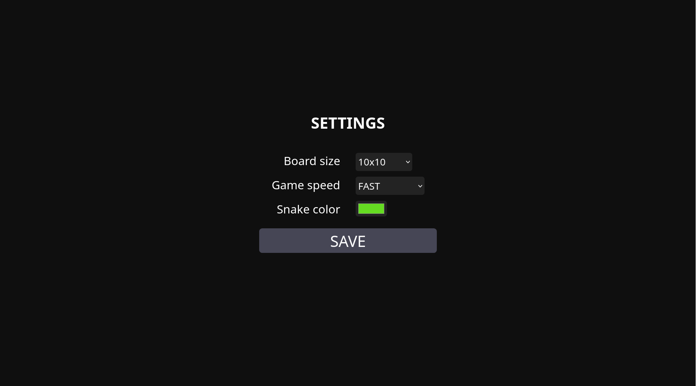
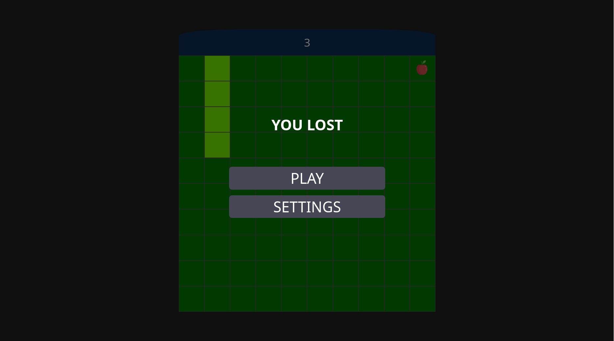

<div align="center">



# Snake

**A browser-based Snake game built with TypeScript, HTML, and CSS**

[](https://github.com/a-jadczak/snake/commits)
[](https://github.com/a-jadczak/snake)
[](https://github.com/a-jadczak/snake)

</div>

## 📋 Table of Contents

- [🎯 Overview](#-overview)
- [✨ Features](#-features)
- [🚀 Demo](#-demo)
- [🖼️ Screenshots](#️-screenshots)
- [🛠️ Tech Stack](#️-tech-stack)
- [🏁 Getting Started](#-getting-started)
- [📖 Usage](#-usage)
- [📁 Project Structure](#-project-structure)
- [📄 License](#-license)

## 🎯 Overview

### **Snake is a single-page browser game where you guide a growing snake around a grid.**

Collect apples to earn points and grow the snake. Avoid the walls and the snake’s own body as the board fills up.

## ✨ Features

### Keyboard controls

Use the arrow keys or **W**, **A**, **S**, and **D** to steer.

### Apples and scoring

Each apple increases the score and grows the snake. Fill the board to win.

### Game settings

Choose an **8 × 8**, **10 × 10**, or **15 × 15** grid, select **SLOW** or **FAST**, and set the snake’s color before playing.

## 🚀 Demo

Start the local server to play in your browser.

### **[→ Open Local Demo](http://localhost:8000/)**

> Follow the Development instructions below to start the server.

## 🖼️ Screenshots

<p align="center">
  
</p>

<p align="center">
  
</p>

<p align="center">
  
</p>

<p align="center">
  
</p>

<p align="center">
  
</p>

## 🛠️ Tech Stack

| Category     | Technologies                  |
| ------------ | ----------------------------- |
| **Frontend** | `HTML` · `CSS` · `TypeScript` |

## 🏁 Getting Started

### 📋 Requirements

| Requirement | Version or purpose                         |
| ----------- | ------------------------------------------ |
| Python      | Python 3 for the local HTTP server         |
| TypeScript  | The `tsc` compiler for rebuilding scripts |

### 📦 Installation

**1. Clone the repository**

```bash
git clone https://github.com/a-jadczak/snake.git
```

**2. Enter the project directory**

```bash
cd snake
```

### 💻 Development

Serve the project root with a local HTTP server.

```bash
python3 -m http.server 8000
```

Then open [http://localhost:8000](http://localhost:8000).

### 🏭 Production Build

Recompile the TypeScript after changing files in `src/`.

```bash
tsc -p tsconfig.json
```

The compiled JavaScript is written to `dist/`.

## 📖 Usage

1. Select **PLAY**.
2. Steer with the arrow keys or **W**, **A**, **S**, and **D**.
3. Collect apples to increase your score while avoiding the walls and the snake’s body.
4. Fill the board to win, or select **PLAY** after a collision to try again.

## 📁 Project Structure

```text
snake/
├── .github/
│   ├── assets/                 # Project screenshots
│   └── portfolio.yaml
├── dist/                       # Compiled JavaScript
├── public/                     # Apple graphic
├── src/                        # Game logic, rendering, input, and settings
├── styles/                     # Game and menu styles
├── index.html                  # Browser entry point
└── tsconfig.json               # TypeScript compiler configuration
```

## 📄 License

This project is licensed under the [MIT License](./LICENSE).

<div align="center">

**[⬆ Back to top](#snake)**

</div>
